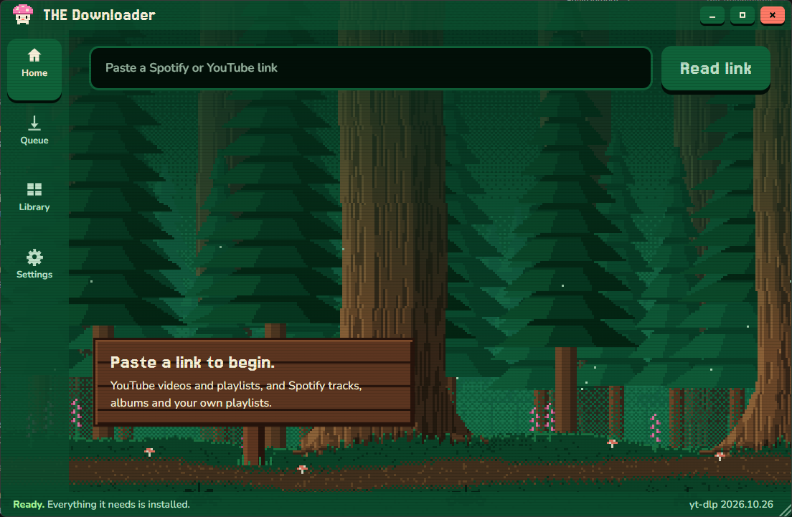
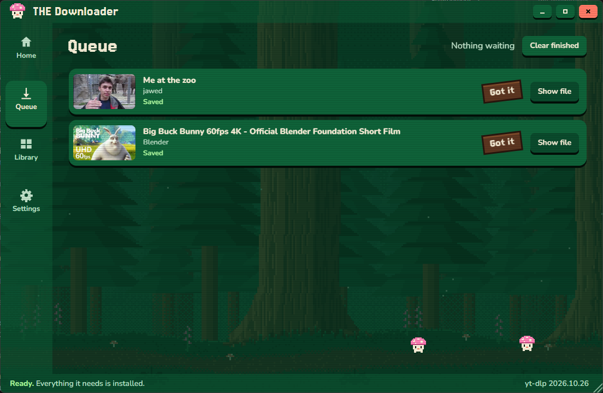

# THE Downloader

A small Windows app that downloads music and videos from **YouTube** and songs from your own **Spotify** playlists, in one window, in a pixel-art forest.



- **YouTube:** single videos and whole playlists, as audio or video (Best, 1080p or 720p).
- **Spotify:** tracks, albums, and playlists you own or collaborate on. Spotify gives no audio, so each song is matched to the same recording on YouTube Music, then tagged with Spotify's title, artist, album and cover.
- **Original quality by default.** Audio is kept as YouTube sends it (usually Opus), without converting it again. mp3 is one click away.
- **A queue that survives a restart.** Pause, resume, cancel, try again, and a Library of everything you downloaded.
- **Playlists get their own folder,** for example `Spotify\Jammies\`.
- **Pick another match** when a Spotify song was matched to the wrong recording.
- **Light on your PC:** about 140 MB of memory when idle and about 210 MB while downloading. It uses no processor time while waiting.



## Before you use it

This is a personal project, shared as it is.

- **YouTube's Terms of Service do not allow downloading** except where YouTube itself offers a download button. Only download what you have the right to keep, such as your own uploads, freely licensed videos, or content whose owner allows it. You are responsible for how you use this app.
- **No audio is ever taken from Spotify.** The app only reads track details through Spotify's official Web API, with your own login, and only from playlists you own or collaborate on.
- THE Downloader is not affiliated with YouTube, Google or Spotify.

## Install (Windows 10 or 11)

1. Install the tools it needs. In a terminal:

   ```
   winget install astral-sh.uv
   winget install Gyan.FFmpeg
   winget install DenoLand.Deno
   winget install OpenJS.NodeJS.LTS
   ```

   uv runs the Python side, ffmpeg converts audio and video, Deno lets yt-dlp read YouTube, and Node.js builds the window's screens once. Close and reopen the terminal afterwards.

2. Get the code and build it:

   ```
   git clone https://github.com/xburrito64/the-downloader.git
   cd the-downloader
   uv sync
   cd ui
   npm install
   npm run build
   cd ..
   ```

3. Add it to the Start menu and the desktop:

   ```
   uv run thedownloader shortcuts
   ```

   From then on, open **THE Downloader** like any other app, with its mushroom icon. To keep it on the taskbar, right-click it in the Start menu and pick "Pin to taskbar". `uv run thedownloader shortcuts --remove` takes the shortcuts away again.

   Without shortcuts, `uv run thedownloader app` opens it from a terminal.

If something is missing, the app says so in **Settings**, under "What the app needs".

## Spotify setup (only for Spotify links)

1. Go to the [Spotify Developer Dashboard](https://developer.spotify.com/dashboard), log in, and create an app. Pick **Web API**.
2. Add this Redirect URI: `http://127.0.0.1:43117/callback`
3. Copy the app's **Client ID** into THE Downloader's Settings, then press **Log in to Spotify**.

No client secret is needed. The login is stored on your PC only, in `%LOCALAPPDATA%\THE Downloader`.

## Where things go

- Downloads: `Downloads\THE Downloader\YouTube` and `...\Spotify` by default. Folder and file names can be changed in Settings.
- Settings, history and the login: `%LOCALAPPDATA%\THE Downloader`.

## From the terminal

Everything also works without the window. `uv run thedownloader --help` lists the commands, for example:

```
uv run thedownloader download "https://www.youtube.com/watch?v=..."
uv run thedownloader match "Artist" "Song title"
uv run thedownloader check
```

## Licence

MIT, see [LICENSE](LICENSE). The libraries, fonts and programs it builds on, and their licences, are listed in [THIRD_PARTY.md](THIRD_PARTY.md). The full development log is in [SPEC.md](SPEC.md).
